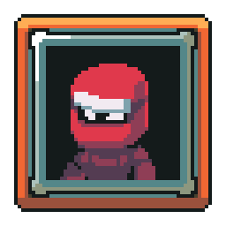
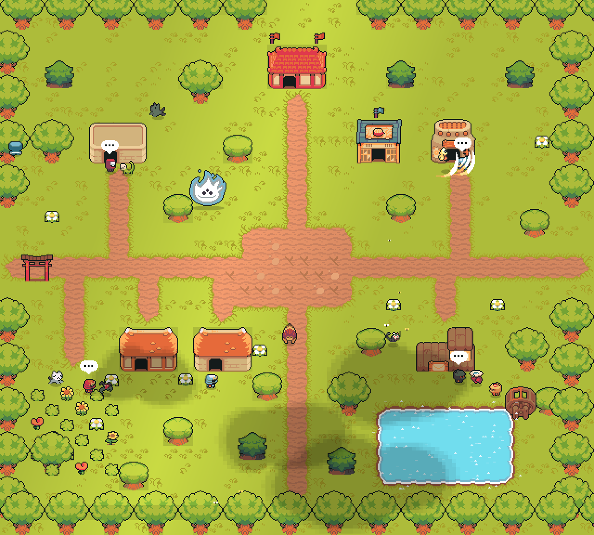
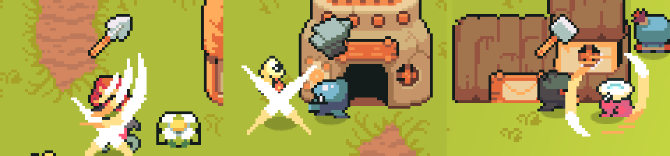
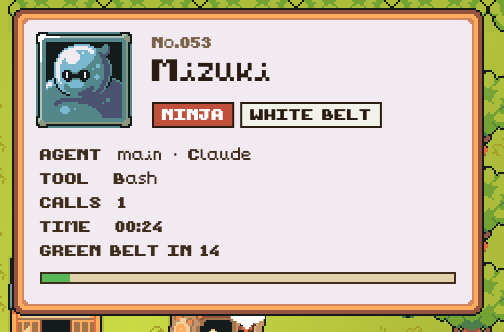
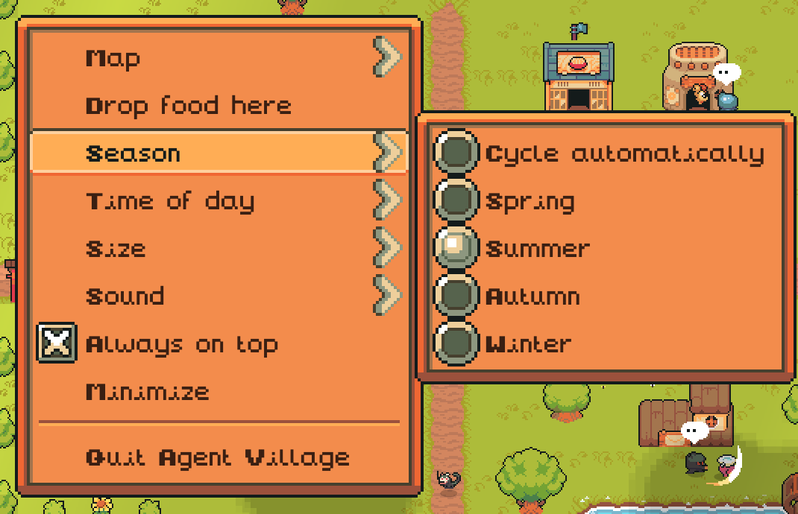
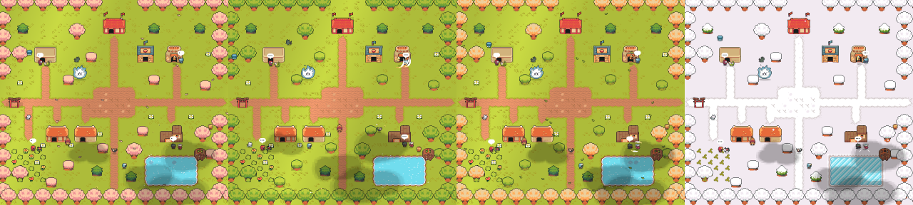
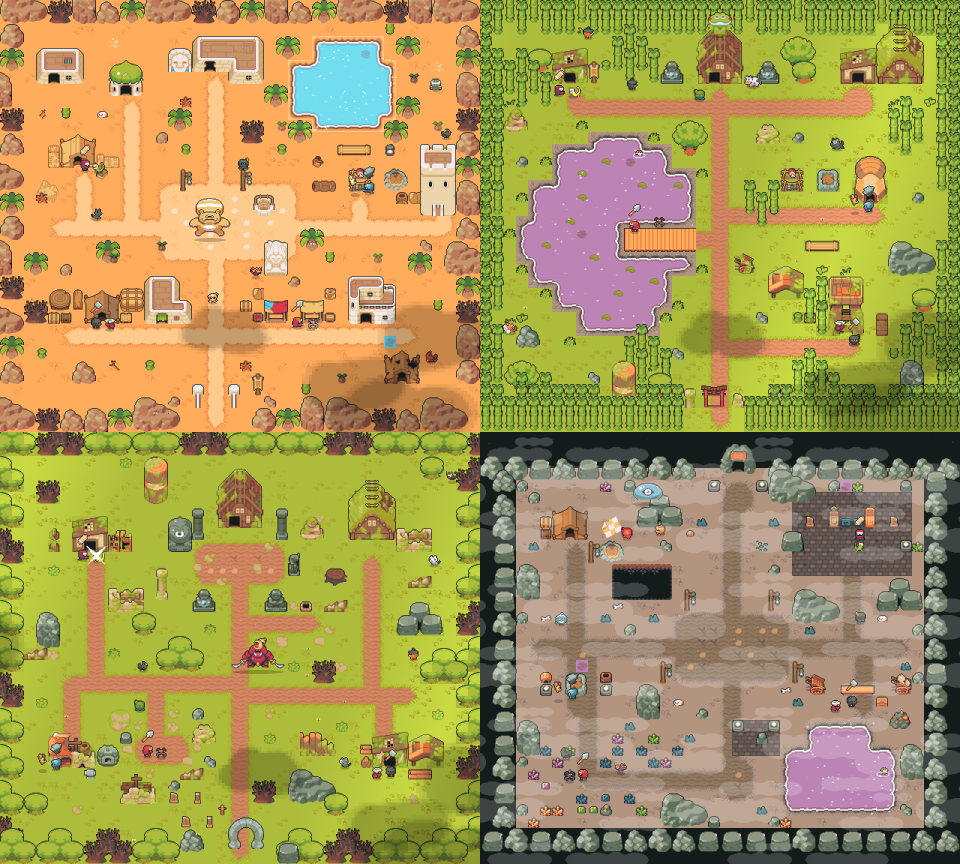

<p align="center"></p>

# Agent Village

A small desktop window (macOS and Windows) with a pixel village in it. Every Claude Code or Codex agent you run is a ninja. When it starts working, a monster turns up in front of it and they fight until the work is done, at the station for the tool it is using: the library when it reads files, the blacksmith when it runs shell commands, the workshop when it edits, the garden when it searches, the dojo when it starts a subagent. Between jobs a few ninjas wait around the village with the animals that live there, while the seasons and the time of day change.

<p align="center"></p>

<p align="center"></p>

Built with Tauri 2. The Rust side listens on `127.0.0.1:4343/event` and passes each hook payload to the canvas front end. It only accepts requests from hooks: anything a web browser sends (it carries an `Origin` header) is turned away, so an open web page can't post fake events to the village.

## Download

Get the latest version from [Releases](https://github.com/batuhan-bas/agent-village/releases/latest):

- **macOS** (Apple Silicon and Intel): `Agent Village_<version>_universal.dmg`, signed and notarized. Open it and drag the app to Applications.
- **Windows**: the `.msi` or the `-setup.exe` installer. They are not signed yet, so SmartScreen may warn on first launch: choose "More info", then "Run anyway".

On first launch the app offers to connect your agents (see below).

## Run from source

```bash
npm install
npm run dev
```

Send a test event:

```bash
curl -X POST http://127.0.0.1:4343/event -H 'Content-Type: application/json' \
  -d '{"hook_event_name":"PreToolUse","session_id":"s1","tool_name":"Bash"}'
```

## Connect your agents

The app doesn't look for agents on its own. Claude Code and Codex tell it what they are doing through hooks: small messages they send to `127.0.0.1:4343` before each tool call, when a call fails, and when a subagent, a turn or a session ends.

On the first run the app asks whether to connect the agents it finds on your machine, and adds its hooks to their settings for you. Everything else in those files stays as it was, and the old file is kept next to it as `*.agent-village-backup`. Later you can switch each one on or off from the right-click menu, under **Agents**.

Both get command hooks that pipe each payload to the app with `curl`, in the background, with a one-second timeout. When the app isn't running they stay silent and never hold up the agent.

- **Claude Code** gets them in `~/.claude/settings.json`. The `SessionEnd` hook waits for `curl` instead of running in the background, because it fires while the session closes; it is what sends a session's ninja back to waiting when you exit, `/clear` or switch sessions. Earlier versions used `http` hooks here, which made Claude Code warn on every tool call while the app was closed. Connecting again (right-click, **Agents**, off and on) replaces them.
- **Codex** gets them in `~/.codex/hooks.json` (it uses `curl.exe` on Windows). Open `/hooks` in Codex once to review and trust the new hooks, because Codex skips hooks it hasn't been told to trust.

To set them up by hand instead, merge `hooks/claude-settings.example.json` or `hooks/codex-hooks.example.json` into those files; they are the same hooks the app adds.

Each session and subagent gets its own ninja. One of the ninjas waiting in the village takes the job (another walks in to wait), and goes back to waiting when the session or subagent ends. Click a ninja to see its card: which agent it works for, whether it came from Codex or Claude, which tool it is using, how many calls it has made, how long it has been working and how far it is from its next belt.

<p align="center"></p>

## In the village

- **Right-click** for the menu, drawn in the pack's own wood theme: pick the map, the season and the time of day (or let them cycle), the window size and the sound, keep the window on top, drop food for the locals, minimize or quit.
- **Press and drag** a creature to move it. While you hold it, the tiles it can't stand on are shaded: walkers need open ground, swimmers can also use the pond, and fish stay in the water. **Click** a creature to see its card, and **double-click** to make it hop. Press anywhere else to drag the window.
- A working ninja fights a monster from the pack: it swings its sword, cuts flash on the monster and knock it back, and the monster claws back now and then. If the ninja moves to another station, the monster follows. When the turn or the subagent ends, the monster goes up in smoke. The tool's icon floats over the ninja's head, and a typing bubble means it's thinking between tools.
- A failed tool call is the monster landing a blow: a storm breaks over the ninja, it is knocked flat for a moment and the guardian flinches.
- Ninjas earn a green belt after 15 tool calls and a black belt after 40. When the main session finishes its turn, the sun comes out and its ninja waits with a question mark; anyone left alone for a minute dozes off.
- When an agent starts a subagent, a shuriken flies from it to the newcomer. A finished subagent leaves a treasure chest and a flower behind, and the counter in the corner goes up; it earns a silver cup at 10 and a gold one at 50. Now and then (and whenever someone earns a black belt) a dragon flies over.
- Flags wave, the watermill turns, plants sway and ripples come and go on the water. Petals, leaves and snow fall in their seasons, cloud shadows drift over the ground, and the sun sends shafts of light in the early morning.
- Creatures give each other room. Before they set off they pick a spot nobody is using, and they wait or step aside when they meet on the path.

<p align="center"></p>

## Seasons

The village goes from spring blossom to autumn leaves. In winter the ground is covered in snow and the pond freezes; everyone can walk on the ice, and the fish keep out of sight until spring.

<p align="center"></p>

## Maps

Right-click, then Map, to move between them. Each has its own buildings for the seven stations, its own guardian (a giant from the pack that stands watch and never moves) and its own music.

- **Agent Village**: dojo, library, blacksmith, workshop, a pond and a flower garden.
- **Sand Camp**: tents and an oasis in the desert.
- **Bamboo Marsh**: a bamboo grove around a swamp.
- **Old Ruins**: an abandoned village.
- **Deep Cave**: underground, so it has no seasons.

<p align="center"></p>

## Sound

Right-click, then Sound, to turn the music and the effects on or off. Music starts off. Each map has a quiet ambient loop (a river or the wind), it rains while a storm lasts, and ninjas murmur when they speak. Effects play when a ninja arrives, earns a belt or finishes, when a tool call fails (with a lightning strike), when the main session finishes its turn, when someone eats the food you dropped, and when you pick creatures up and drop them.

## Art, sound and how the maps are made

All art and audio come from the [Ninja Adventure asset pack](https://pixel-boy.itch.io/ninja-adventure-asset-pack) by pixel-boy and AAA, released under CC0 (see `src/art/LICENSE.txt`). The ninjas got names of their own (Raiden, Homura, Mizuki, Kuro and the rest). The scripts below need Python 3 with Pillow and the unzipped pack.

- `npm run maps -- <pack>` builds every map described in `scripts/maps/<id>.py` (see `village.py` for a full example) into `src/maps/<id>/`: one image per season, a water mask, the winter ice and a `meta.json`. Paths and ponds are drawn with the pack's own floor-matching rules (`scripts/floor-terrain.json`). `npm run index` then gathers the maps into `src/maps.json`, `src/collision.json` and `src/water.json`.
- `npm run actors -- <pack>` copies the characters, monsters, animals and guardians into `src/art/actors/` and lists them in `src/creatures.json` with what each one can do (fly, swim, or live in the water only). It also copies their extra poses, the guardians' hit animations, the effects, food, items, emotes, dialog boxes, the wood theme used by the menu, the pixel font, animated map pieces, particles and the dragon. Pigs are left out on purpose.
- `python3 scripts/import-audio.py <pack>` copies the sound effects into `src/audio/`, and converts the ambient loops and the music the maps use to AAC (it needs ffmpeg).
- `npm test` checks that, on every map, every station can reach every other one without walking through anything, and that the example hook files forward every event the app reacts to. `cargo test` in `src-tauri` checks that connecting adds the hooks once, keeps your own settings, and that disconnecting puts the file back as it was.

## Releasing

Bump the version in `package.json`, `src-tauri/tauri.conf.json` and `src-tauri/Cargo.toml`, then push a tag such as `v0.2.0`. GitHub Actions builds the Windows installers and puts them on a draft release. The Mac build is signed and notarized on a Mac with the Developer ID certificate and uploaded to the same release:

```bash
APPLE_SIGNING_IDENTITY="Developer ID Application: Calexis Labs OU (B5XU49S3PN)" npx tauri build --target universal-apple-darwin
DMG="src-tauri/target/universal-apple-darwin/release/bundle/dmg/Agent Village_0.2.0_universal.dmg"
codesign -s "Developer ID Application: Calexis Labs OU (B5XU49S3PN)" "$DMG"
xcrun notarytool submit "$DMG" --keychain-profile agent-village --wait
xcrun stapler staple "$DMG"
gh release upload v0.2.0 "$DMG"
```

The `agent-village` keychain profile is made once with `xcrun notarytool store-credentials`. When both builds are on the draft, publish it from the Releases page.
